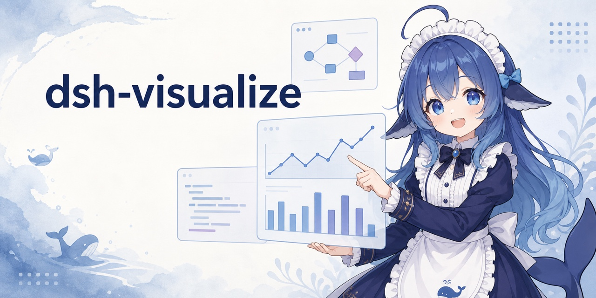
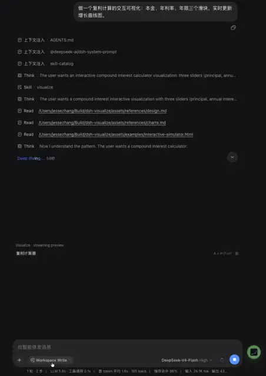

# dsh-visualize



<p align="center">
  <a href="README.md">简体中文</a> | <strong>English</strong>
</p>

<p align="center">
  <a href="https://dshfind.com/en/plugins/Nagi-ovo/dsh-visualize?ref=badge"></a>
</p>

DSH does not have to answer with text alone. When the model calls `visualize`, the Web UI renders an interactive card inside the conversation for simulators, charts, comparison panels, and UI mockups.

<div align="center">

[](assets/demo.mp4)

</div>

## Install

Install from npm into DSH's `web` profile:

```sh
dsh plugin --profile web add @nagi-ovo/dsh-visualize
# If dsh web is running, restart it and refresh the page.
```

GitHub also works: `dsh plugin --profile web add github:Nagi-ovo/dsh-visualize`. Run `dsh --profile web --dump-config` to confirm that the plugin is present in the final configuration. For local development, clone the repository and run `dsh plugin --profile web add .` from its root; committed build output means no separate build step is required. Users of the community [plugin-registry](https://github.com/dsh-external/plugin-registry) can also install it from Settings → Plugins.

Compatible with DSH 0.1.1-rc.2 through 0.2.1-rc.2.

## Use it

Tell the model what you want to explore, for example, “make an adjustable visualization of a sorting algorithm.” The model calls `visualize` with the whole HTML fragment as its `fragment` argument (plus an optional `title` and `mode`), and the card starts rendering while the model is still writing it. Side-by-side comparisons can use `mode: "wide"`. To correct a card it already drew, the model calls `action: "update"` with the card's `path` and one exact `old_str` → `new_str` replacement instead of resending the markup; `path` is only used by `update`.

When the thing to build is bigger than a chat card, such as a dashboard with filters, a multi-view tool, a full-screen simulation, or a complete desktop mockup, the model builds a standalone page with `mode: "page"`. The conversation shows a launcher card with the title, a one-line description (the `summary` argument), a live thumbnail of the page, and an **Open page** button that opens the page full-size in a new tab. If the browser blocks the tab, **Show here** displays the page in the conversation instead. After an `update`, a tab you already opened keeps the old version; click **Open page** again to see the change.

Cards follow the DSH light or dark theme and, in the default style, its whale-blue palette (other styles below). When the chat column is too narrow, the **Open in new window** button at the right of the card header opens the card full-size in its own tab, themed as DSH was when you opened it and still running inside the same sandboxed iframe. Session replay restores cards from the persistent tool result, so the original fragment file does not need to remain on disk.

A copy of each card's fragment is saved to `~/.dsh/visualize/sessions/<session id>/<title>-<hash>.<style>.html` (under `$DSH_HOME/visualize/` when `DSH_HOME` is set), one directory per conversation and never inside your project, so `git status` stays free of `viz/`. `update` patches that copy. Cards that older versions wrote under `viz/` in the workspace can still be updated in place. The plugin does not clean these files up; you can delete `~/.dsh/visualize/` at any time and existing conversations still replay their cards.

By default DSH folds a finished turn's tool process. While it does, the turn's cards also appear under the final answer, so you see them without opening the process; with Work details set to Verbose they stay in place only.

Cards can hand something back to the conversation. When you click a button in a quiz, a choice, or a form, the card puts a sentence such as "I picked B — explain why A is wrong" into the composer. Nothing is sent for you: edit it and send it, or don't. If you are already writing a draft, the card leaves it alone and shows a notice instead. This needs DSH 0.1.7 or later and does not work in a card opened in a new window, where the card hides those buttons.

## Card styles

The plugin ships five card styles; the default is `whale`. In DSH, open **More** (bottom left) → **Settings** → **Visualize**: each style shows a live preview card rendered in the current light or dark theme, and one click saves it. The next card uses it, without a restart.

The page needs DSH 0.1.7 or later (the host's settings forms, `configForms`, and its `/api` routes; in 0.1.7, Settings sits at the bottom of the sidebar). Earlier versions either lack the page or show only the snippet below; add this to `<DSH_HOME>/profiles/web/cordis.patch.yml` (`~/.dsh/profiles/web/cordis.patch.yml` by default) instead:

```yaml
- id: dsh-visualize
  name: "@nagi-ovo/dsh-visualize"
  config:
    style: sketch
```

The settings page writes the same entry: it goes through the host's dsh-settings into that `cordis.patch.yml`, keeping the file's other entries and comments.


| `style` | Look | Good for |
| --- | --- | --- |
| `whale` | Whale blue (default): the DSH palette and system type | anything |
| `editorial` | Serif headline that states the finding, one highlighted line with the rest in grey, direct labels | trends, comparisons, "what does this number say" |
| `paper` | Serif type, L-shaped axes, colour-blind-safe palette, colour plus marker double encoding, "Figure 1 ·" captions | results, learning curves, explanations with formulas |
| `sketch` | Handwritten type, rough.js strokes, highlighter notes | concepts, intuition, flows |
| `terminal` | Monospace, square corners, dashed grid, key–value labels | latency, throughput, step-by-step algorithms |

A style has two layers. The card shell injects the colours, fonts, radius and chart defaults (grid, axis lines, line width), each tuned for both light and dark themes, with the background left transparent. The layout and writing conventions (how titles read, captions, rough.js) are a short guide appended to the skill for the model. That guide replaces only the taste advice in `design.md`: fragment rules, the CSP, theme variables, the 11px floor and lint still apply. Product UI mockups ignore the style and follow the product being drawn.

Each card records the style it was created with in its persisted result and in its saved copy's file name, so changing the setting later leaves existing cards alone, on replay, in "Open in new window", and when the model patches one with `update`. Cards saved before styles existed have no style in their name, and an `update` re-renders them in the current setting. The preview that renders while the model is still writing a card reads the setting when the DSH page loads; switching on the settings page updates the current page too, and after editing the YAML by hand, reload open pages. `editorial`, `paper`, `sketch` and `terminal` load their fonts from Google Fonts; `paper` loads KaTeX only when a card contains formulas.

### Custom styles

Write your preferences in plain language in a Markdown file, e.g. "dark green accent, titles under eight words, one decimal place". The plugin appends it after the built-in guide:

- Global: `~/.dsh/visualize/style.md` (`$DSH_HOME/visualize/style.md` when `DSH_HOME` is set), for every session.
- Workspace: `<workspace>/.dsh/visualize-style.md`, for sessions in that workspace only.

Both files can also be viewed and edited at the bottom of **Settings → Visualize** (also DSH 0.1.7+), one per workspace; saving an empty file deletes it.

When they conflict, what you say in the conversation wins, then the workspace file, then the global file, then the built-in style. Only the first 4 KB of each file is read, and a missing file is skipped. Edits apply the next time the model loads the visualize skill (usually the first card of a new session). A custom style changes how the model writes cards, not the colours and fonts the shell injects; to change colours, say so in the file and the model overrides the matching theme variables on the card's root element.

## Security

Each card runs in a sandboxed iframe with an opaque origin and cannot access the host page. Opening a card in a new window, including a page's **Open page**, keeps that: the new tab carries no model code of its own, and the fragment still runs only inside an iframe with the same sandbox and CSP, so it cannot read DSH's cookies, localStorage, or login token. Its CSP blocks network requests, nested pages, and form submissions, while allowing static assets from a fixed set of CDNs. Fragments are limited to `1000000` bytes by default; change `maxFragmentBytes` to use a different limit. When a card fills the composer, the DSH page does the checking: it accepts the request only from that card's own iframe and only after your click, limits its length and rate, writes only into an empty composer, and never sends on your behalf.

## Limitations

Interactive cards currently render only in the Web UI. TUI and headless clients show the standard tool result instead. A card can fill the composer but cannot send a message itself.

Inspired by `/visualize` in the Codex desktop app. The layered skill references and Chart.js-first approach draw from [himself65/finance-skills](https://github.com/himself65/finance-skills/tree/main/plugins/ui-tools/skills/generative-ui).
